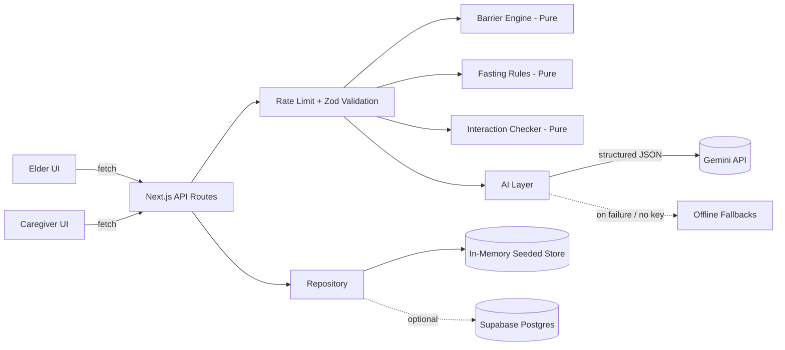

# Saathi — Elderly Medication Companion

> **Reminders solve forgetting. Saathi solves all the reasons elders miss medicines.**

🎬 **Demo Video:** https://drive.google.com/file/d/1exPcMNaulomFE8BIwu4sv5H4Uy0kO_EZ/view?usp=sharing

Saathi is an elderly-care medication companion for the **Catalyst Solo AI Hackathon** that goes beyond simple alarms by:
- 🧠 **Kyun Chhoda?** — Understanding *why* a dose was missed (7 barrier categories) and taking cause-specific action
- 🩺 **Doctor Ki Baat** — Converting doctor visits into simple notes, draft medicines, and overlap warnings
- 🕌 **Vrat-Roza-Tyohar Planner** — Planning medicines around fasting days (Ekadashi, Navratri, Roza, Paryushan, Karva Chauth)

## ✨ Features

| Feature | Description |
|---------|-------------|
| **Barrier Engine** | Classifies skip reasons via voice/text/tap cards → 7 categories → specific actions |
| **Memory Bridge** | Doctor note → 5 simple lines + draft medicines + duplicate detection |
| **Fasting Planner** | Per-medicine guidance (with food / empty stomach OK / ask doctor) + doctor questions |
| **Offline-First** | Works without API key via deterministic fallbacks |
| **Accessibility** | 20px+ text, 64px taps, AAA contrast, Hindi/English, read-aloud, SOS button |
| **Safety** | Human-in-the-loop, draft-only AI outputs, deterministic high-risk rules |

## 🏗 Architecture



### Layers
| Layer | Location | Responsibility |
|-------|----------|----------------|
| Presentation | `src/app`, `src/components` | Elder & caregiver screens, accessibility |
| API | `src/app/api/*` | Input validation, rate limiting, orchestration |
| Domain (Pure) | `src/lib/barrier`, `src/lib/fasting` | Rules that decide actions, no I/O |
| AI | `src/lib/ai` | Prompts, Gemini client, schemas, fallbacks |
| Data | `src/lib/db` | Repository interface, in-memory + Supabase |
| Security | `src/lib/security` | Env validation, rate limiting, sanitization |

## 🚀 Quick Start

### Prerequisites
- Node.js 20+
- npm

### Installation

```bash
# Clone and install
git clone https://github.com/rudrakhairnar16-bit/saathi.git
cd saathi
npm install

# Optional: Add Gemini API key for AI features
echo "GEMINI_API_KEY=your_key_here" > .env.local
echo "GEMINI_MODEL=gemini-2.5-flash" >> .env.local

# Development
npm run dev

# Production build
npm run build
npm start
```

### Environment Variables

| Variable | Required | Default | Description |
|----------|----------|---------|-------------|
| `GEMINI_API_KEY` | No | — | Enables AI features (offline fallbacks work without) |
| `GEMINI_MODEL` | No | `gemini-2.5-flash` | Gemini model to use |
| `NEXT_PUBLIC_APP_URL` | No | `http://localhost:3000` | App URL for production |
| `SUPABASE_URL` | No | — | Enable Supabase persistence |
| `SUPABASE_ANON_KEY` | No | — | Supabase anonymous key |

## 🧪 Testing

```bash
# Run all tests
npm test

# Type checking
npm run typecheck

# Linting
npm run lint

# Format code
npm run format
```

## 📁 Project Structure

```
src/
├── app/
│   ├── (elder)/           # Elder screens (home, medicines, why-skipped, doctor-note, vrat-plan)
│   ├── (caregiver)/       # Caregiver dashboard
│   └── api/               # API routes
│       ├── dose/skip
│       ├── doctor/note
│       ├── fasting/plan
│       ├── elder/[id]/schedule
│       ├── elder/[id]/alerts
│       ├── medicine/confirm
│       └── fasting/confirm
├── components/
│   └── ui/                # BigButton, TextSizeToggle, SOSButton, SkipReasonCards, etc.
├── lib/
│   ├── ai/                # Gemini client, prompts, schemas, fallbacks
│   ├── barrier/           # Classifier, decision logic, types
│   ├── db/                # Repository interface, in-memory implementation
│   ├── fasting/           # Rules, plan builder
│   ├── overlap/           # Interaction checker
│   ├── security/          # Env validation, rate limiting, sanitization
│   └── messages.ts        # Friendly messages (EN/HI)
├── types/                 # Shared TypeScript types
└── middleware.ts          # Rate limiting, security headers
```

## ♿ Accessibility Checklist

- [ ] Body text ≥ 20px (configurable A/A+/A++)
- [ ] Tap targets ≥ 64×64px with 16px spacing
- [ ] WCAG AAA contrast (7:1) + high-contrast mode
- [ ] Read-aloud on every screen (speechSynthesis)
- [ ] Voice input (Web Speech API) + tap card fallback
- [ ] Semantic HTML, visible focus rings, ARIA live regions
- [ ] Hindi (Devanagari) + English language support
- [ ] No swipe/hover/drag-only actions
- [ ] Single column, one task per screen
- [ ] Icon + label on every control
- [ ] Lighthouse/axe score ≥ 95 on elder screens

## 🛡️ Security

- **Secrets**: `GEMINI_API_KEY` server-only, validated at startup
- **Input**: Zod validation on every route, 500 char limit, control char stripping
- **Prompt Injection**: User text delimited as data, output schema-validated
- **Abuse**: Per-IP rate limiting on AI routes (20/min global, 10/min AI)
- **Access Control**: Role checks on confirm actions, Supabase RLS
- **Transport**: HTTPS on Vercel, security headers (nosniff, frame-deny, etc.)
- **Medical Safety**: AI outputs are drafts, emergency messages for red flags
- **Data**: Fictional seed data only, no real PII

## 🤖 AI Skills Used

| Skill | Purpose |
|-------|---------|
| **Context7** | Current docs for Next.js 16, React 19, Tailwind v4, Zod 4, `@google/genai` |
| **21st.dev** | UI component inspiration (restyled to accessibility specs) |
| **Strix** | Security scan of deployed demo |
| **Graphify** | Architecture map for README |
| **Ponytail** | Code review, simplification |

## 📦 Deployment

### Vercel (Recommended)

1. Push to GitHub
2. Import in Vercel
3. Add environment variables:
   - `GEMINI_API_KEY`
   - `GEMINI_MODEL`
4. Deploy

### Manual

```bash
npm run build
npm start
```

## 🧑‍💻 Development Commands

```bash
npm run dev          # Start dev server
npm run build        # Production build
npm run start        # Start production server
npm run typecheck    # TypeScript check
npm run test         # Run Vitest tests
npm run test:watch   # Watch mode
npm run lint         # ESLint
npm run format       # Prettier
```

## 📄 License

MIT — See [LICENSE](LICENSE) for details.

## 🙏 Acknowledgments

- Built for **Catalyst Solo AI Hackathon** (Makers Need More × Google for Developers × Hack2Skill)
- Inspired by real elders: Kamla Ben (72, Vadodara), Rahul (40, son), Dr. Mehta
- Uses **Google Gemini** for language understanding
- Accessibility guided by **WCAG 2.1 AAA** and **Atkinson Hyperlegible** font

---

**Not a medical device.** Saathi never diagnoses, prescribes, or changes doses. Always consult your doctor.